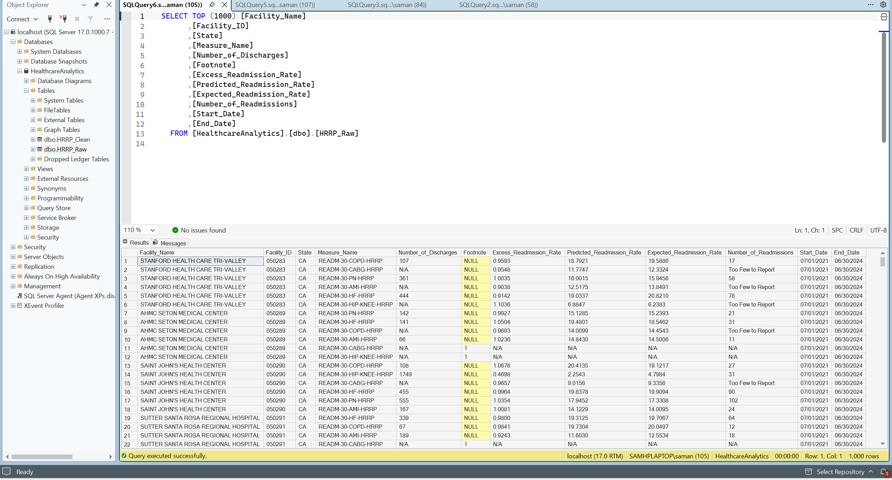
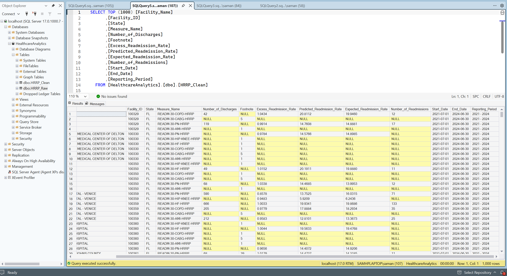

# Healthcare Hospital Readmissions Analytics

**Tools:** SQL Server | T-SQL | CMS Healthcare Data

## Project Overview

This project analyzes hospital readmission performance using publicly available data from the Centers for Medicare & Medicaid Services (CMS) Hospital Readmissions Reduction Program (HRRP).

The goal was to transform raw healthcare data into a structured, analysis-ready dataset using SQL Server. The project demonstrates an end-to-end SQL data preparation workflow, including database and table creation, data staging, data cleaning, type conversion, missing value handling, and analytical querying.

By separating raw source data from cleaned data, this project establishes a reliable foundation for healthcare performance analysis and future business intelligence reporting.

## Project Objectives

- Import and organize raw CMS HRRP data in SQL Server.
- Build staging and cleaned data structures.
- Clean and standardize source data using T-SQL.
- Convert raw text fields into appropriate numeric and date data types.
- Handle missing, invalid, and inconsistent values.
- Prepare a structured dataset for analytical queries.
- Explore hospital readmission performance across clinical conditions and reporting periods.

## Data Source

**CMS Hospital Readmissions Reduction Program (HRRP)**

The HRRP program evaluates hospital readmission performance using risk-adjusted measures across selected clinical conditions.

This project uses publicly available hospital-level readmission data from CMS.

Source: [CMS Provider Data](https://data.cms.gov/provider-data/)

## Data Workflow

The project follows a SQL-based data preparation workflow:

```text
CMS HRRP Source Data
        |
        v
SQL Server Database
        |
        v
Raw Staging Tables
        |
        v
SQL Data Cleaning & Transformation
        |
        v
Cleaned HRRP Dataset
        |
        v
Analytical SQL Queries
        |
        v
Healthcare Performance Insights
```

## SQL Implementation

SQL Server and T-SQL were used to prepare the source data and create a cleaned dataset for analysis.

### 1. Database and Table Creation

- Created the SQL Server database and table structures.
- Established staging tables to store the original HRRP data.
- Organized SQL scripts into separate stages for table creation, data cleaning, and analysis.

### 2. Data Cleaning and Transformation

Applied SQL transformations to improve data consistency and reliability, including:

- Used `TRY_CONVERT()` to convert raw fields into appropriate numeric and date data types.
- Used `NULLIF()` to handle placeholder and missing values.
- Applied `LTRIM()` and `RTRIM()` to remove unnecessary whitespace from text fields.
- Standardized reporting-period and condition fields.
- Separated raw staging data from the cleaned reporting dataset.

### 3. Analytical Queries

Developed SQL queries to explore and evaluate the cleaned healthcare dataset, including:

- Hospital readmission performance.
- Clinical condition comparisons.
- Reporting-period analysis.
- Data summaries and aggregations.

## Data Transformation: Raw vs. Cleaned Data

The following screenshots illustrate the transformation from the original CMS source data to the cleaned dataset prepared in SQL Server.

### Raw HRRP Data

The original source data was loaded into SQL Server staging tables before cleaning and transformation.



### Cleaned HRRP Data

SQL transformations were applied to standardize fields, convert data types, and prepare the dataset for downstream analysis.



## Repository Structure

```text
healthcare-hrrp-powerbi-analytics/
│
├── SQL/
│   ├── 01_create_tables.sql
│   ├── 02_clean_hrpp_data.sql
│   └── 03_analysis_queries.sql
│
├── Screenshots/
│   ├── HRRP_Raw_Data.png
│   └── HRRP_Cleaned_Data.png
│
└── README.md
```

## How to Run

1. Download the CMS HRRP source dataset.
2. Open SQL Server Management Studio (SSMS).
3. Execute `01_create_tables.sql` to create the database and table structures.
4. Load the source data into the appropriate staging table.
5. Execute `02_clean_hrpp_data.sql` to perform data cleaning and transformation.
6. Execute `03_analysis_queries.sql` to explore the cleaned dataset.

*Note: Update any source file paths or SQL Server connection references in the scripts to match your local environment.*

## Skills Demonstrated

| Category | Skills |
|---|---|
| SQL Development | SQL Server, T-SQL |
| Data Cleaning | Missing value handling, type conversion, text standardization |
| Data Transformation | Staging tables, structured datasets |
| Data Analysis | Aggregations, analytical queries, healthcare metrics |
| Documentation | GitHub, project organization |

## Future Enhancements

- Develop an interactive Power BI dashboard.
- Create executive KPIs for hospital readmission performance.
- Add condition-level and geographic comparisons.
- Incorporate reporting-period trends and year-over-year analysis.

---

**Project Focus:** Healthcare Analytics | SQL Development | Data Cleaning | Data Transformation
